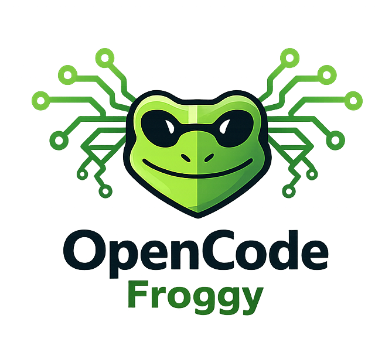
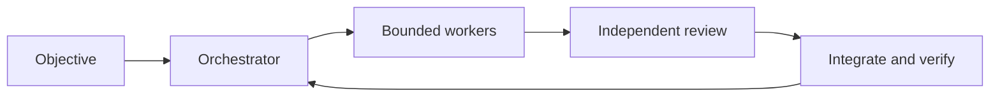

<p align="center">
  
</p>

<p align="center">
  <a href="https://github.com/smartfrog/opencode-froggy/actions"></a>
  <a href="https://www.npmjs.com/package/opencode-froggy"></a>
</p>

# OpenCode Froggy

OpenCode Froggy brings **multi-agent delegation**, **durable project memory**, and **general-purpose tools** to OpenCode, guided by Extreme Programming.

**Clear objectives. Focused agents. Simple solutions. Verified results.**

## Quick start

### Install

Add the plugin to your OpenCode configuration:

```json
{
  "$schema": "https://opencode.ai/config.json",
  "plugins": ["opencode-froggy"]
}
```

Requires OpenCode V2.

For local development, clone or copy the plugin into:

- **Project-local:** `.opencode/plugins/opencode-froggy/`
- **Global:** `~/.config/opencode/plugins/opencode-froggy/`

### Start working

1. Select the `orchestrator` agent for coordinated delivery, or `product-owner` when the product direction is still being shaped.
2. State the objective and the acceptance criteria you care about.
3. Let the orchestrator delegate bounded work, review it, and integrate verified results.

Project memory needs no separate service. Agents read the project’s canonical memory directly; durable updates go through the bundled `memory-manager`.

## Documentation map

| Guide | Read it for |
|---|---|
| [Orchestration](docs/orchestration.md) | Agents, delegation, review, integration, workspaces, coordination loop, model pools |
| [Project memory](docs/memory.md) | Task board, knowledge, revisions, discovery, ownership, legacy Markdown, diagrams |
| [Reference](docs/reference.md) | Commands, skills, utility tools, configuration |

## Orchestration

The `product-owner` clarifies intent, scope, priorities, and acceptance before execution. The orchestrator then turns that objective into a sequence of bounded assignments: it decides what to do, chooses workers and models, requests independent review, and integrates only verified revisions.



Workers return results, checks tied to an exact revision, blockers, and evidence paths. A non-trivial change set needs independent review before completion. Temporary workspaces are released only after every user, background process, branch, and recovery reference has been checked.

The optional [coordination loop](docs/orchestration.md#coordination-loop) keeps sustained work moving with a short periodic reminder.

## Project memory

Froggy separates **current execution state** from **durable knowledge**:

| Store | Purpose |
|---|---|
| `task-board` | Title, status and one current task description |
| `knowledge` | Valuable constraints, performance tips, pitfalls and decisions grouped by topic |

Both live in one SQLite database per canonical project, shared across worktrees. All agents may read. Only `memory-manager` writes; it decides which knowledge to keep, correct, merge or remove from current state. Coordinators supply verified facts and execution decisions, not final memory prose. Recovery retains only the current and immediately previous version, not a complete history.

Read the affected task first, then use knowledge `topics`/`list`/`search` and `get` only what you need. Tools return complete Markdown, but rendering may be truncated: narrow discovery with a status, topic or query and obtain any missing content before replacing a record. If the full read is blocked, report it instead of rewriting from excerpts. Do not load the whole store.

See [Project memory](docs/memory.md) for the model, curation rules, tools and upgrades. Utility tool parameters are in [Reference](docs/reference.md#utility-tools).

### task-board

Simple task tracking with `todo`, `in-progress`, `blocked`, `review` and `done`. All agents read with `list`/`get`; the manager writes with `save`, using the current `expectedVersion` for an existing task. Descriptions are current syntheses, not histories: replace obsolete state instead of appending updates. There are no task notes; only one previous version is retained for recovery.

### knowledge

Topic-organized durable knowledge. Use `list`, ranked full-text `search` and `get` for discovery. Search excerpts show matching passages; large records support version-checked character slices. The manager uses `save` or version-checked `remove`; only the last saved content survives removal, recoverable through `history` and `restore`. It may also refuse low-value material or return `No change`. Use an explicit verified `memory-backup` before broad curation: two successive edits replace the recovery buffer. Neither pruning nor removal securely erases SQLite pages or backups.

Run `/memory-review` on demand for a global knowledge review. The read-only `memory-review` tool inventories topics; `memory-reviewer` reads all entries and proposes corrections, merges or removals for your validation. Nothing is applied during the review.

## Agents

| Agent | Mode | Description |
|---|---|---|
| `product-owner` | primary | Clarifies product intent, scope, priorities, and acceptance; produces an actionable backlog. |
| `orchestrator` | primary | Coordinates execution, delegates work, requests review, integrates verified results, and reports honestly. |
| `architect` | subagent | Strategic technical advisor for architecture and complex trade-offs. Read-only. |
| `doc-writer` | subagent | Technical writer for README, API, architecture, and user documentation. |
| `code-reviewer` | subagent | Independent review of correctness, regressions, security, and maintainability. |
| `code-simplifier` | subagent | Simplifies recently modified code while preserving behavior. |
| `memory-manager` | subagent | Sole task/knowledge writer; curates current records, restores saved versions and creates verified backups. |
| `memory-reviewer` | subagent | Read-only knowledge audit; proposes changes without mutation, backup or delegation access. |
| `partner` | subagent | Strategic ideation partner that expands solution spaces. Read-only. |
| `rubber-duck` | subagent | Thinking partner that listens, reflects, and asks focused questions. Read-only. |

### orchestrator

The `orchestrator` is a primary agent that owns execution decisions. It does not write task or knowledge records directly; it supplies verified facts and decisions to `memory-manager`, then verifies the saved receipt. See [Orchestration](docs/orchestration.md).

## Commands

| Command | Description | Agent |
|---|---|---|
| `/agent-promote <name> [grade]` | Promote an agent to primary (default), subagent, or all. | — |
| `/agent-demote <name>` | Demote an agent to subagent. | — |
| `/commit-push` | Stage, commit, and push changes with confirmation. | `build` |
| `/diff-summary [source] [target]` | Show working-tree changes or branch diffs. | — |
| `/doc-changes` | Update documentation for new uncommitted features. | `doc-writer` |
| `/gh-create-pr` | Commit, push, and create a GitHub pull request. | `build` |
| `/knowledge [list\|search\|get] ...` | Browse or search project knowledge without modifying it. | — |
| `/linear-stale-check` | Review open Linear issues for likely relevance. | `plan` |
| `/memory` | Show task counts by status and knowledge topics with totals. | — |
| `/memory-review` | Review all project knowledge and propose cleanup for user validation. | `memory-reviewer` |
| `/release` | Prepare and execute a release with explicit confirmation. | — |
| `/review-changes` | Review staged, unstaged, and untracked changes. | `code-reviewer` |
| `/review-pr <source> <target>` | Review a branch diff into a target branch. | `code-reviewer` |
| `/send-to [agent] <message>` | Continue a child session through the native subagent tool. | — |
| `/session-context [limit]` | Analyze context usage for recent sessions. | — |
| `/simplify-changes` | Simplify uncommitted changes. | `code-simplifier` |
| `/task-board [list <status>\|done\|get <ID>]` | Show tasks as status columns without `done`, filter one status, or show one task. | — |
| `/tests-coverage` | Run coverage and suggest fixes for failures. | `build` |

The `/memory`, `/task-board` and `/knowledge` commands call a tool that returns Markdown.
The tool does the formatting; the model only relays its output without reformatting it.

Selected command details are in [Reference](docs/reference.md#commands).

## Tools

| Domain | Tools | Guide |
|---|---|---|
| Memory | `memory-overview`, `task-board`, `knowledge`, `memory-review` | [Project memory](docs/memory.md) |
| Orchestration | `start-orchestrator-loop`, `stop-orchestrator-loop`, `orchestrator-status` | [Orchestration](docs/orchestration.md#coordination-loop) |
| Utilities | `gitingest`, `list-child-sessions`, `session-context`, `pdf-to-markdown`, `agent-promote` | [Reference](docs/reference.md#utility-tools) |

Session context reports are available through `/session-context` or its tool, in Markdown only; there is no standalone CLI.

## Configuration

The plugin loads agents, commands, and skills from its bundled directories.

Model pools are configured in the first existing file:

1. `.opencode/orchestrator.md` in the project;
2. `~/.config/opencode/orchestrator.md`.

```markdown
complex: provider/model-a#max, provider/model-b#xhigh
normal: provider/model-c
```

## License

MIT
