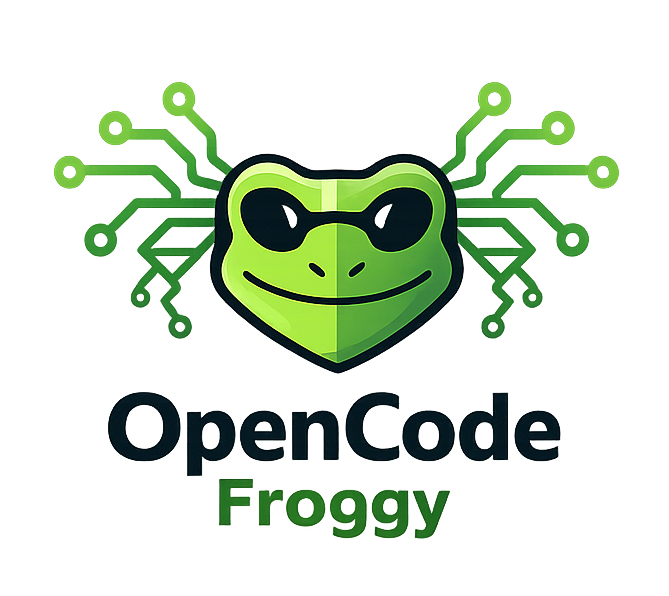
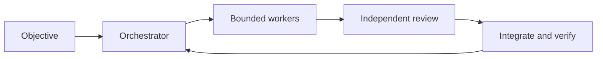

<p align="center">
  
</p>

<p align="center">
  <a href="https://github.com/smartfrog/opencode-froggy/actions"></a>
  <a href="https://www.npmjs.com/package/opencode-froggy"></a>
</p>

# OpenCode Froggy

OpenCode Froggy brings **multi-agent delegation**, **durable project memory**, **Ethereum/EVM tools**, and **event hooks** to OpenCode, guided by Extreme Programming.

**Clear objectives. Focused agents. Simple solutions. Verified results.**

## Quick start

### Install

Add the plugin to your OpenCode configuration:

```json
{
  "$schema": "https://opencode.ai/config.json",
  "plugins": ["opencode-froggy"]
}
```

Requires OpenCode V2.

For local development, clone or copy the plugin into:

- **Project-local:** `.opencode/plugins/opencode-froggy/`
- **Global:** `~/.config/opencode/plugins/opencode-froggy/`

### Start working

1. Select the `orchestrator` agent for coordinated delivery, or `product-owner` when the product direction is still being shaped.
2. State the objective and the acceptance criteria you care about.
3. Let the orchestrator delegate bounded work, review it, and integrate verified results.

Project memory needs no separate service. Agents read the project’s canonical memory directly; durable updates go through the bundled `memory-manager`.

## Documentation map

| Guide | Read it for |
|---|---|
| [Orchestration](docs/orchestration.md) | Agents, delegation, review, integration, workspaces, coordination loop, model pools |
| [Project memory](docs/memory.md) | Task board, knowledge, revisions, discovery, ownership, legacy Markdown, diagrams |
| [Ethereum and EVM](docs/ethereum.md) | Chain support, API key setup, transaction and address tools, decoded events |
| [Hooks](docs/hooks.md) | Events, conditions, actions, blocking behavior, context, examples |
| [Reference](docs/reference.md) | Commands, skills, utility tools, configuration, code extensions |

## Orchestration

The `product-owner` clarifies intent, scope, priorities, and acceptance before execution. The orchestrator then turns that objective into a sequence of bounded assignments: it decides what to do, chooses workers and models, requests independent review, and integrates only verified revisions.



Workers return results, checks tied to an exact revision, blockers, and evidence paths. A non-trivial change set needs independent review before completion. Temporary workspaces are released only after every user, background process, branch, and recovery reference has been checked.

The optional [coordination loop](docs/orchestration.md#coordination-loop) keeps sustained work moving with a short periodic reminder.

## Project memory

Froggy separates **current execution state** from **durable knowledge**:

| Store | Purpose |
|---|---|
| `task-board` | Title, status, detailed description and short progress notes |
| `knowledge` | Valuable constraints, performance tips, pitfalls and decisions grouped by topic |

Both live in one SQLite database per canonical project, shared across worktrees. All agents may read. Only `memory-manager` writes; it decides which knowledge to keep, correct, merge or permanently delete. Coordinators supply verified facts and execution decisions, not final memory prose.

Read the affected task first, then use knowledge `list`/`search` and `get` only what you need. Follow `nextPage` with `page` for incomplete results. Do not load the whole store.

See [Project memory](docs/memory.md) for the model, curation rules, tools and upgrades. Utility tool parameters are in [Reference](docs/reference.md#utility-tools).

### task-board

Simple task tracking with `todo`, `in-progress`, `blocked`, `review` and `done`. Use `list`/`get` to read; the manager uses `save` and `note`. Updates require the version just read, without keeping old revisions.

### knowledge

Topic-organized durable knowledge. Use `list`, `search` and `get` for discovery. The manager uses `save` or version-checked `remove`; removal is permanent, not archival. It may also refuse low-value material or return `No change`.

Run `/memory-review` on demand for a global knowledge review. The read-only `memory-review` tool inventories topics; the manager reads all entries and proposes corrections, merges or removals for your validation. Nothing is applied during the review.

## Ethereum and EVM

Froggy includes read-only tools for Ethereum and other EVM-compatible chains through public RPC and Etherscan V2 APIs:

- `eth-transaction` — transaction details, optional internal transactions, token transfers, and decoded logs;
- `eth-address-balance` — native balance;
- `eth-address-txs` — transaction history;
- `eth-token-transfers` — ERC-20 transfers.

Supported chains include Ethereum, Polygon, BSC, Arbitrum, Optimism, Base, Avalanche, Fantom, and zkSync. `ETHERSCAN_API_KEY` is required for address balance, transaction history, token transfers, and internal transactions; base transaction details use a public RPC. The tools never sign or send transactions.

See [Ethereum and EVM](docs/ethereum.md) for parameters, output shapes, examples, and limitations.

## Hooks

Hooks run local actions on session and tool events. They are useful for formatting, linting, validation, logging, and guards that must block a tool before it changes a file.

```yaml
hooks:
  - event: session.idle
    conditions: [hasCodeChange, isMainSession]
    actions:
      - bash: "npm run lint --fix"
      - command: simplify-changes
```

Hooks are loaded from the OpenCode configuration directories, merged global-first, and run in declaration order. A `tool.before.*` hook can block a tool with exit code `2`.

See [Hooks](docs/hooks.md) for all events, conditions, actions, context, exit codes, and examples.

## Agents

| Agent | Mode | Description |
|---|---|---|
| `product-owner` | primary | Clarifies product intent, scope, priorities, and acceptance; produces an actionable backlog. |
| `orchestrator` | primary | Coordinates execution, delegates work, requests review, integrates verified results, and reports honestly. |
| `architect` | subagent | Strategic technical advisor for architecture and complex trade-offs. Read-only. |
| `doc-writer` | subagent | Technical writer for README, API, architecture, and user documentation. |
| `code-reviewer` | subagent | Independent review of correctness, regressions, security, and maintainability. |
| `code-simplifier` | subagent | Simplifies recently modified code while preserving behavior. |
| `memory-manager` | subagent | Sole task/knowledge writer; decides what knowledge to retain, correct, merge or permanently remove. |
| `partner` | subagent | Strategic ideation partner that expands solution spaces. Read-only. |
| `rubber-duck` | subagent | Thinking partner that listens, reflects, and asks focused questions. Read-only. |

### orchestrator

The `orchestrator` is a primary agent that owns execution decisions. It does not write task or knowledge records directly; it supplies verified facts and decisions to `memory-manager`, then verifies the saved receipt. See [Orchestration](docs/orchestration.md).

## Commands

| Command | Description | Agent |
|---|---|---|
| `/agent-promote <name> [grade]` | Promote an agent to primary (default), subagent, or all. | — |
| `/agent-demote <name>` | Demote an agent to subagent. | — |
| `/commit-push` | Stage, commit, and push changes with confirmation. | `build` |
| `/diff-summary [source] [target]` | Show working-tree changes or branch diffs. | — |
| `/doc-changes` | Update documentation for new uncommitted features. | `doc-writer` |
| `/gh-create-pr` | Commit, push, and create a GitHub pull request. | `build` |
| `/linear-stale-check` | Review open Linear issues for likely relevance. | `plan` |
| `/memory-review` | Review all project knowledge and propose cleanup for user validation. | `memory-manager` |
| `/release` | Prepare and execute a release with explicit confirmation. | — |
| `/review-changes` | Review staged, unstaged, and untracked changes. | `code-reviewer` |
| `/review-pr <source> <target>` | Review a branch diff into a target branch. | `code-reviewer` |
| `/send-to [agent] <message>` | Continue a child session through the native subagent tool. | — |
| `/session-context [limit]` | Analyze context usage for recent sessions. | — |
| `/simplify-changes` | Simplify uncommitted changes. | `code-simplifier` |
| `/tests-coverage` | Run coverage and suggest fixes for failures. | `build` |

Selected command details are in [Reference](docs/reference.md#commands).

## Tools

| Domain | Tools | Guide |
|---|---|---|
| Memory | `task-board`, `knowledge`, `memory-review` | [Project memory](docs/memory.md) |
| Orchestration | `start-orchestrator-loop`, `stop-orchestrator-loop`, `orchestrator-status` | [Orchestration](docs/orchestration.md#coordination-loop) |
| Ethereum/EVM | `eth-transaction`, `eth-address-balance`, `eth-address-txs`, `eth-token-transfers` | [Ethereum and EVM](docs/ethereum.md) |
| Utilities | `gitingest`, `list-child-sessions`, `session-context`, `pdf-to-markdown`, `agent-promote` | [Reference](docs/reference.md#utility-tools) |

## Configuration

The plugin loads agents, commands, and skills from its bundled directories. Hooks are loaded from the standard OpenCode hook locations.

Model pools are configured in the first existing file:

1. `.opencode/orchestrator.md` in the project;
2. `~/.config/opencode/orchestrator.md`.

```markdown
complex: provider/model-a#max, provider/model-b#xhigh
normal: provider/model-c
```

Ethereum tools use `ETHERSCAN_API_KEY` for address/token queries and internal transactions. See [Ethereum and EVM](docs/ethereum.md#configuration).

`hasCodeChange` checks the extensions listed in [Hooks conditions](docs/hooks.md#conditions). Hooks without conditions run on every matching event; the condition is only needed to filter on modified code files.

## License

MIT
