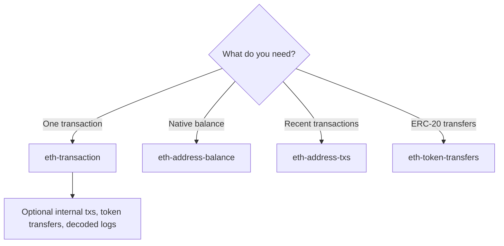

# Ethereum and EVM tools

Froggy includes read-only tools for inspecting Ethereum and other EVM-compatible chains through public RPC and Etherscan V2 APIs. The tools return transaction, address, balance, token-transfer, and decoded-event data; they do not sign or send transactions.

[Back to README](../README.md)

## Contents

- [Supported chains](#supported-chains)
- [Configuration](#configuration)
- [eth-transaction](#eth-transaction)
- [eth-address-balance](#eth-address-balance)
- [eth-address-txs](#eth-address-txs)
- [eth-token-transfers](#eth-token-transfers)
- [Choosing a tool](#choosing-a-tool)
- [Safety and limits](#safety-and-limits)

## Supported chains

All blockchain tools support multiple chains via the `chainId` parameter:

| Chain ID | Network |
|----------|---------|
| `1` | Ethereum (default) |
| `137` | Polygon |
| `56` | BSC |
| `42161` | Arbitrum |
| `10` | Optimism |
| `8453` | Base |
| `43114` | Avalanche |
| `250` | Fantom |
| `324` | zkSync |

## Configuration

The tools use two read paths:

- base `eth-transaction` details use a public RPC through viem;
- address balance, address transactions, token transfers, and internal transaction details use the Etherscan V2 API.

**Environment Variable:**

| Variable | Required for | Description |
|----------|--------------|-------------|
| `ETHERSCAN_API_KEY` | Address/token queries and internal transactions | Etherscan V2 API key |

An API key is required for `eth-address-balance`, `eth-address-txs`, `eth-token-transfers`, and `eth-transaction` with `includeInternalTxs: true`. Base `eth-transaction` receipt, block, log, and token-metadata paths can work without it.

**Getting an API key:**

1. Create a free account at [etherscan.io](https://etherscan.io/register)
2. Navigate to API Keys in your account settings
3. Generate a new API key

**Setting the environment variable:**

```bash
export ETHERSCAN_API_KEY="your-api-key-here"
```

Without the key, Etherscan-backed calls return a clear configuration error instead of silently falling back.

## eth-transaction

Get Ethereum transaction details by transaction hash. Returns status, block, addresses, gas costs in JSON format. Use optional parameters to include internal transactions, token transfers, and decoded event logs.

### Parameters

| Parameter | Type | Required | Default | Description |
|-----------|------|----------|---------|-------------|
| `hash` | `string` | Yes | - | Transaction hash (0x...) |
| `chainId` | `string` | No | `"1"` | Chain ID (see table above) |
| `includeInternalTxs` | `boolean` | No | `false` | Include internal transactions (ETH transfers between contracts) |
| `includeTokenTransfers` | `boolean` | No | `false` | Include ERC-20 token transfers |
| `decodeLogs` | `boolean` | No | `false` | Decode event logs (Transfer, Approval, Deposit, Withdrawal) |

### Usage Examples

```typescript
// Get basic transaction details on Ethereum mainnet
ethTransaction({ hash: "0x123abc..." })

// Get transaction on Polygon
ethTransaction({
  hash: "0x123abc...",
  chainId: "137"
})

// Get transaction with internal transactions and token transfers
ethTransaction({
  hash: "0x123abc...",
  includeInternalTxs: true,
  includeTokenTransfers: true
})

// Get full transaction details with decoded event logs
ethTransaction({
  hash: "0x123abc...",
  includeInternalTxs: true,
  includeTokenTransfers: true,
  decodeLogs: true
})
```

### Output Structure

The tool returns JSON with address objects. Contract labels are not currently resolved, so `label` is `null`:

```json
{
  "hash": "0x123...",
  "status": "success",
  "block": 12345678,
  "from": { "address": "0xabc...", "label": null },
  "to": { "address": "0xdef...", "label": null },
  "value": "0",
  "gas": { "used": 150000, "price": "20000000000", "cost": "0.003" }
}
```

With `includeInternalTxs: true`:
```json
{
  "internalTransactions": [
    {
      "from": { "address": "0x...", "label": null },
      "to": { "address": "0x...", "label": null },
      "value": "1.5",
      "type": "call"
    }
  ]
}
```

With `includeTokenTransfers: true`:
```json
{
  "tokenTransfers": [
    {
      "token": { "address": "0x...", "name": "Wrapped Ether", "symbol": "WETH", "decimals": 18 },
      "from": { "address": "0x...", "label": null },
      "to": { "address": "0x...", "label": null },
      "value": "1.5"
    }
  ]
}
```

With `decodeLogs: true`:
```json
{
  "decodedEvents": [
    {
      "name": "Transfer",
      "address": { "address": "0x...", "label": null },
      "params": { "from": "0x...", "to": "0x...", "value": "1500000000000000000" }
    }
  ],
  "undecodedEventsCount": 2
}
```

### Supported Decoded Events

| Event | Description |
|-------|-------------|
| `Transfer` | ERC-20 token transfer |
| `Approval` | ERC-20 approval for spending |
| `Deposit` | WETH deposit (ETH → WETH) |
| `Withdrawal` | WETH withdrawal (WETH → ETH) |

## eth-address-balance

Get the ETH balance of an Ethereum address. Returns balance in both ETH and Wei.

### Parameters

| Parameter | Type | Required | Default | Description |
|-----------|------|----------|---------|-------------|
| `address` | `string` | Yes | - | Ethereum address (0x...) |
| `chainId` | `string` | No | `"1"` | Chain ID (see table above) |

### Usage Examples

```typescript
// Get balance on Ethereum mainnet
ethAddressBalance({ address: "0xd8dA6BF26964aF9D7eEd9e03E53415D37aA96045" })

// Get balance on Arbitrum
ethAddressBalance({
  address: "0xd8dA6BF26964aF9D7eEd9e03E53415D37aA96045",
  chainId: "42161"
})
```

## eth-address-txs

List Ethereum transactions for an address. Shows incoming and outgoing transactions with values, timestamps, and status.

### Parameters

| Parameter | Type | Required | Default | Description |
|-----------|------|----------|---------|-------------|
| `address` | `string` | Yes | - | Ethereum address (0x...) |
| `limit` | `number` | No | `20` | Maximum number of transactions to return |
| `chainId` | `string` | No | `"1"` | Chain ID (see table above) |

### Usage Examples

```typescript
// List recent transactions on Ethereum mainnet
ethAddressTxs({ address: "0xd8dA6BF26964aF9D7eEd9e03E53415D37aA96045" })

// List last 50 transactions on Base
ethAddressTxs({
  address: "0xd8dA6BF26964aF9D7eEd9e03E53415D37aA96045",
  limit: 50,
  chainId: "8453"
})
```

## eth-token-transfers

List ERC-20 token transfers for an Ethereum address. Shows token names, symbols, values, and transaction details.

### Parameters

| Parameter | Type | Required | Default | Description |
|-----------|------|----------|---------|-------------|
| `address` | `string` | Yes | - | Ethereum address (0x...) |
| `limit` | `number` | No | `20` | Maximum number of transfers to return |
| `chainId` | `string` | No | `"1"` | Chain ID (see table above) |

### Usage Examples

```typescript
// List recent token transfers on Ethereum mainnet
ethTokenTransfers({ address: "0xd8dA6BF26964aF9D7eEd9e03E53415D37aA96045" })

// List last 100 token transfers on Optimism
ethTokenTransfers({
  address: "0xd8dA6BF26964aF9D7eEd9e03E53415D37aA96045",
  limit: 100,
  chainId: "10"
})
```

---

## Choosing a tool



## Safety and limits

- The tools are read-only: they do not hold keys, sign messages, or submit transactions.
- Etherscan-backed results depend on Etherscan indexing; base transaction details use a public RPC. A missing result is not proof that an on-chain event never occurred.
- Contract labels are currently `null`; do not infer a contract name from an address object.
- `ETHERSCAN_API_KEY` is required for address/token queries and internal transaction details.
- Chain support and response detail can differ between public RPC and Etherscan-backed paths.

## Related

- [Reference](reference.md)
- [Project memory](memory.md)
