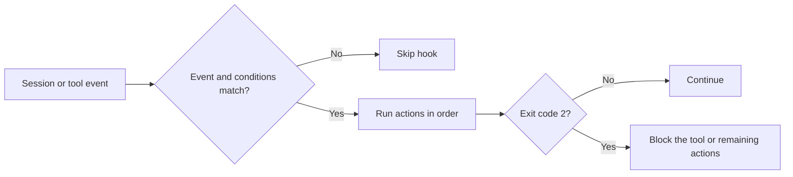

# Hooks

Hooks run actions when session or tool events occur. They are useful for automatic formatting, linting, validation, logging, and guards that must run before a tool changes a file.

This page explains how hooks are discovered, configured, matched, and executed. It is a behavior guide, not an implementation reference.

[Back to README](../README.md)

## Contents

- [How a hook runs](#how-a-hook-runs)
- [Configuration locations](#configuration-locations)
- [File format](#configuration-file-format)
- [Events](#supported-events)
- [Execution order](#tool-hook-execution-order)
- [Conditions](#conditions)
- [Actions](#supported-actions)
- [Execution behavior](#execution-behavior)
- [Examples](#example-hook-configurations)

## How a hook runs



A hook has three parts:

- an **event** that triggers it;
- optional **conditions** that must all pass;
- ordered **actions** to run.

Hooks do not replace agent decisions or project permissions. They are local automation around the event stream.

## Configuration Locations

Hooks are loaded from these locations (in order, merged together):

| Platform | Global | Project |
|----------|--------|---------|
| Linux | `~/.config/opencode/hook/hooks.md` | `<project>/.opencode/hook/hooks.md` |
| macOS | `~/.config/opencode/hook/hooks.md` | `<project>/.opencode/hook/hooks.md` |
| Windows | `~/.config/opencode/hook/hooks.md` or `%APPDATA%/opencode/hook/hooks.md` | `<project>/.opencode/hook/hooks.md` |

On Windows, `~/.config` is preferred for cross-platform consistency. If hooks exist in `%APPDATA%` but not in `~/.config`, the `%APPDATA%` location is used.

Global hooks run first, then project hooks are added. Hooks from both sources are combined (not overridden).

## Configuration File Format

- YAML frontmatter must include a `hooks` list
- Each hook defines `event`, `actions`, and optional `conditions`
- Hooks for the same event run in declaration order

Example `hooks.md`:

```markdown
---
hooks:
  - event: session.idle
    conditions: [hasCodeChange, isMainSession]
    actions:
      - command: simplify-changes
---
```

## Supported Events

| Event | Description |
|-------|-------------|
| `session.idle` | Emitted when a session becomes idle. Hooks run if defined; use `hasCodeChange` to filter on modified code files. |
| `session.created` | Emitted when a session is created |
| `session.deleted` | Emitted when a session is deleted |
| `tool.before.*` | Emitted before any tool executes. Exit code 2 blocks the tool. |
| `tool.before.<name>` | Emitted before a specific tool (e.g., `tool.before.write`). Exit code 2 blocks the tool. |
| `tool.after.*` | Emitted after any tool executes |
| `tool.after.<name>` | Emitted after a specific tool (e.g., `tool.after.edit`) |

### Tool Hook Execution Order

1. `tool.before.*` (all tools)
2. `tool.before.<name>` (specific tool)
3. *(tool executes)*
4. `tool.after.*` (all tools)
5. `tool.after.<name>` (specific tool)

### Blocking Tools with Exit Code 2

For `tool.before.*` and `tool.before.<name>` hooks, a bash action returning exit code 2 will block the tool from executing. The stderr output is displayed to the user as the block reason.

## Conditions

| Condition | Description |
|-----------|-------------|
| `isMainSession` | Run only for the main session (not sub-sessions) |
| `hasCodeChange` | Run only if at least one modified file looks like code |

All listed conditions must pass for the hook to run.

**Code extensions treated as "code":**

`ts`, `tsx`, `js`, `jsx`, `mjs`, `cjs`, `json`, `yml`, `yaml`, `toml`, `css`, `scss`, `sass`, `less`, `html`, `vue`, `svelte`, `go`, `rs`, `c`, `h`, `cpp`, `cc`, `cxx`, `hpp`, `java`, `py`, `rb`, `php`, `sh`, `bash`, `kt`, `kts`, `swift`, `m`, `mm`, `cs`, `fs`, `scala`, `clj`, `hs`, `lua`.

## Supported Actions

### Command Action

Execute a plugin command.

```yaml
# Short form
- command: simplify-changes

# With arguments
- command:
    name: review-pr
    args: "main feature"
```

If the command exists in config, the plugin reuses its `agent` and `model`.

### Tool Action

Prompt the session to use a tool with specific arguments.

```yaml
- tool:
    name: bash
    args: { command: "echo done" }
```

### Bash Action

Execute a shell command directly without involving the LLM. Useful for running linters, formatters, build scripts, or custom automation.

**Configuration:**

```yaml
# Short form
- bash: "npm run lint"

# Long form with custom timeout
- bash:
    command: "$OPENCODE_PROJECT_DIR/.opencode/hooks/init.sh"
    timeout: 30000  # milliseconds (default: 60000)
```

**Environment Variables:**

The plugin injects these variables into the child process environment:

| Variable | Value | Use case |
|----------|-------|----------|
| `OPENCODE_PROJECT_DIR` | Absolute path to the project (e.g., `/home/user/project`) | Reference project files from scripts located elsewhere |
| `OPENCODE_SESSION_ID` | The OpenCode session identifier | Logging, tracing, or conditioning actions based on session |

**Stdin JSON Context:**

The command receives a JSON object via stdin with session context:

```json
{
  "session_id": "abc123",
  "event": "session.idle",
  "cwd": "/path/to/project",
  "files": ["src/index.ts", "src/utils.ts"]
}
```

The `files` array is only present for `session.idle` events and contains paths modified via `write`, `edit`, or `patch`.

For tool hooks (`tool.before.*`, `tool.after.*`), additional fields are provided:

```json
{
  "session_id": "abc123",
  "event": "tool.before.write",
  "cwd": "/path/to/project",
  "tool_name": "write",
  "tool_args": { "filePath": "src/index.ts", "content": "..." }
}
```

**Environment Variables vs Stdin JSON:**

- **Environment variables**: Direct access via `$VAR`, convenient for simple values like paths and IDs
- **Stdin JSON**: Contains richer context (event type, working directory, modified files), requires parsing with `jq` or similar

Both mechanisms are complementary. Use environment variables for quick access to project path and session ID; use stdin JSON when you need event details or the list of modified files.

**Exit Codes:**

| Code | Behavior |
|------|----------|
| `0` | Success, continue to next action |
| `2` | Blocking error, stop remaining actions in this hook |
| Other | Non-blocking error, log warning and continue |

**Result Feedback:**

Bash hook results are automatically sent back to your session:

```
[BASH HOOK ✓] npm run lint
Exit: 0 | Duration: 1234ms
Stdout: All files passed linting
```

The feedback includes a status icon (✓ success, ✗ failure), exit code, execution duration, and stdout/stderr output (truncated to 500 characters). This message appears in your session but does not trigger a response from the assistant.

## Execution Behavior

- Action errors are logged and do not stop later actions.
- `session.idle` is emitted when a session becomes idle; an idle hook with no conditions can run with an empty file list. `hasCodeChange` requires at least one modified file with a recognized code extension.
- Tracked files come from the `write`, `edit`, and `patch` tools. The session's modified-file list is cleared after the idle hook runs.
- `isMainSession` evaluates the current session's `parentID` at execution time; it does not rely on a stored main-session flag.

## Example Hook Configurations

### Basic Multi-Hook Setup

```markdown
---
hooks:
  - event: session.idle
    conditions: [hasCodeChange, isMainSession]
    actions:
      - bash: "npm run lint --fix"
      - command: simplify-changes

  - event: session.created
    actions:
      - bash:
          command: "$OPENCODE_PROJECT_DIR/.opencode/hooks/init.sh"
          timeout: 30000
      - command:
          name: review-pr
          args: "main feature"
---
```

### Simple Lint-on-Idle Hook

```yaml
hooks:
  - event: session.idle
    conditions: [hasCodeChange]
    actions:
      - bash: "npm run lint --fix"
```

### Custom Initialization Script

`.opencode/hooks/init.sh`:

```bash
#!/bin/bash
set -e

# Read JSON context from stdin
context=$(cat)
session_id=$(echo "$context" | jq -r '.session_id')
event=$(echo "$context" | jq -r '.event')
cwd=$(echo "$context" | jq -r '.cwd')

echo "Session $session_id triggered $event in $cwd"

# Use environment variables
echo "Project: $OPENCODE_PROJECT_DIR"

# Exit 0 for success, 2 to block remaining actions
exit 0
```

### Conditional Blocking Based on Lint Errors

```bash
#!/bin/bash
# Run linter and block if critical errors found
if ! npm run lint 2>&1 | grep -q "critical"; then
  exit 0  # Success, continue
else
  echo "Critical lint errors found, blocking further actions"
  exit 2  # Block remaining actions
fi
```

### Block Modifications to Sensitive Files

```yaml
hooks:
  - event: tool.before.write
    actions:
      - bash: |
          file=$(cat | jq -r '.tool_args.filePath // .tool_args.file_path // .tool_args.path')
          if echo "$file" | grep -qE '\.(env|pem|key)$'; then
            echo "Cannot modify sensitive files: $file" >&2
            exit 2
          fi

  - event: tool.before.edit
    actions:
      - bash: |
          file=$(cat | jq -r '.tool_args.filePath // .tool_args.file_path // .tool_args.path')
          if echo "$file" | grep -qE '\.(env|pem|key)$'; then
            echo "Cannot modify sensitive files: $file" >&2
            exit 2
          fi
```

### Auto-Format TypeScript Files After Write

```yaml
hooks:
  - event: tool.after.write
    actions:
      - bash: |
          file=$(cat | jq -r '.tool_args.filePath // .tool_args.file_path // .tool_args.path')
          if echo "$file" | grep -qE '\.tsx?$'; then
            npx prettier --write "$file"
          fi
```

### Log All Tool Executions

```yaml
hooks:
  - event: tool.before.*
    actions:
      - bash: |
          context=$(cat)
          tool=$(echo "$context" | jq -r '.tool_name')
          echo "[$(date)] Tool: $tool" >> /tmp/opencode-tools.log
```

---

## Related

- [Orchestration](orchestration.md)
- [Project memory](memory.md)
- [Reference](reference.md)
