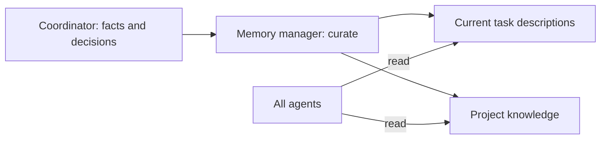

# Project memory

Froggy keeps two things: **simple task tracking** and **valuable project knowledge**.
The goal is to recover what matters, not to preserve a journal of everything that happened.

## Tasks

A task has a stable **ID**, **title**, **status**, and **detailed description**.
Statuses are `todo`, `in-progress`, `blocked`, `review`, and `done`.

The description holds scope, acceptance, current state, next step and useful evidence links.
Keep session/workspace references there when needed to resume work. Title, status and
description must agree with the current established state: replace obsolete blockers,
assignments and former current-state sections rather than keeping a succession of snapshots.
There are no task notes, update feeds or history sections. `save` replaces supplied fields;
it does not append a timeline. Read the current task with `get`, then replace its description
using the returned `expectedVersion`. Keep unique constraints, unresolved risks and recovery
links when removing obsolete prose. Detailed trials stay in linked reports; do not create
reports merely to relocate redundant updates.

The coordinator decides assignments and acceptance. A dispatched worker is not proof of
execution, and a passing static check is not proof that the product objective is achieved.

## Project knowledge

Each entry has an **ID**, **topic**, **title**, and **content** in Markdown.
Topics fit the project: for example `constraints`, `performance`, `build` or `runtime`.
Include useful source links in the content, not separate metadata fields.

Keep information that can change a future decision:

- user constraints and safety limits;
- reproducible performance tips and their conditions;
- build pitfalls, failure causes and recovery procedures;
- non-obvious project facts and design decisions with their reasons.

For example, a 6 GiB memory ceiling or a measured scheduler optimization belongs here.
“Trial #14 launched; results pending” belongs in the task. Raw logs stay in linked files.
Do not duplicate facts already adequately covered by project instructions or documentation.

A knowledge entry states the current conclusion, its conditions and uncertainty, and evidence
links, not the investigation chronology. Replace obsolete explanations when evidence establishes
the replacement instead of appending contradictory verdicts. Keep a refuted lead only when it
helps avoid repeating a mistake: summarize the failed approach, its conditions and the reason,
with a source link. Keep detailed trial sequences, timestamps and measurements in linked reports.

For example, when several trials isolate a capture-only crash and validate a local fix,
retain the failure mechanism, affected configuration, fix, validation limits and report link.
The task holds the remaining blocker and next action, not another copy of each trial.

## The memory manager decides

All agents read directly. **Only `memory-manager` writes tasks and knowledge.**
The coordinator supplies verified new facts, decisions, obsolete conclusions, bounded scope
and evidence—not final prose to copy or a requirement to preserve every previous chain.
The manager decides what to add, correct, merge, refuse or remove.
`No change` is a valid result; quantity is not a quality measure.

Before creating an entry, the manager searches for an existing home. It preserves uncertainty
and does not invent acceptance or authorization. Old or rarely read knowledge is not
automatically useless. Unique constraints, unresolved risks and recovery information stay
unless explicit evidence supersedes them. Preserve recoverability, not exhaustive chronology;
size alone is not a deletion criterion. Explicit user retention instructions still apply.
If unique information cannot safely be condensed or its evidence is missing, report the
limitation rather than discarding it or inventing a report.

`knowledge remove` removes the entry from current reads and search. Only its last saved version
remains recoverable; older recovery versions are discarded. Removal is **not erasure**. Read the full entry first.
Save and verify merged content before removing duplicates, and reconcile affected
references. When uncertain, keep the entry. The handback lists changed IDs, returned
versions, deletion reasons, conflicts and partial writes.

The coordinator checks the resulting affected titles, statuses, blockers and next steps against
its decisions and the supplied evidence, including necessary recovery references. A saved-record
receipt proves persistence, not that the updated state is coherent or that acceptance was met.

Tool checks restrict mutations to the manager's agent context. This is not an OS sandbox:
agents must not bypass the tools with SQL, shell or file edits.

## Reading and writing

Use `/memory`, `/task-board` and `/knowledge` to inspect tasks and knowledge without modifying them. Each command calls one tool; the tool returns Markdown and the model relays it unchanged. Read the relevant task with `task-board get`. Discover knowledge with `topics`/`list`/`search`,
then `get` only matching entries. Do not load the whole project on every reminder.
`project-rules`, if present, is an ordinary knowledge entry, not a special backend.

Knowledge search uses SQLite FTS5 with title/ID weighting, accent-insensitive token matching
and excerpts around matching passages. Whitespace-separated terms are combined with AND;
each term is treated as literal text, not FTS query syntax. Technical paths and identifiers
are searchable, but substring, synonym and cross-language semantic matching are not provided.
Lists and searches still return every match without a hidden result cap.

Tools return complete Markdown by default, but rendering may be truncated. Narrow discovery
with a status, topic or query. For `get`, request `offset: 0, limit: 8000` to read a slice.
Offsets and limits count Unicode code points, not bytes or UTF-16 code units. Each slice
includes metadata, version, character coverage and the next offset; its exact body follows
`--- content ---`. The maximum slice size is 16,000 characters. Continue using the returned
offset and the same `version`; a changed record is rejected rather than mixing versions.

Before replacing a description or content, read the full affected record. If any part remains unread
or inaccessible, stop that replacement and report incomplete coverage; excerpts and summaries
are not enough. Record `get` shows the current version. Lists are discovery views, not
immutable snapshots while other sessions write.

Each task's metadata and description are read together. The plugin does not cap Markdown
responses or impose a display-driven limit on descriptions or knowledge content.

Create records without `expectedVersion`. Updating or removing an existing record requires
its current version. Versions are opaque conflict guards and recovery identifiers; never calculate
the next value. On conflict, report it and reread before deciding how to reconcile.

## Recovery history and backups

Both record tools expose `history` with an `id`, but it is a **one-step recovery buffer**, not
a complete history. For a live record it lists the current version and, after an update,
only the immediately previous version, newest first. Each save replaces that previous version.
For removed knowledge it lists only the last saved version and a distinct removal token;
the removal metadata contains no second copy of the content. Recreating or restoring the
entry drops the removal token and keeps that last saved content as the previous version.

Add `version` to inspect a retained snapshot; `offset` and `limit` can slice it too. Older
versions are discarded transactionally with the change and become unavailable to reads and
restores. Two successive bad edits can therefore lose the last good content. Recovery data
is separate from ordinary lists, search and task descriptions; it is not an activity journal.

Only `memory-manager` can `restore`, using `id`, `restoreVersion` and `expectedVersion`.
Restoration writes a new current version; it never rewinds version counters. For an existing
record, use its current version. For removed knowledge, use the most recent `remove` version
from history; an intervening recreation and removal invalidates the old token. Read and
verify the restored current record, including its references, before reporting recovery.
For an existing record, the state replaced by restoration becomes its one previous version.

The manager can call `memory-backup` with no arguments to create a uniquely named, local
`memory.db.backup-<unique-id>.bak`. The tool serializes a consistent read snapshot, verifies
the written bytes, database integrity and table counts, and returns the standalone backup's
path and size. It does not create or upgrade a missing/outdated database, restore anything,
publish data or remove older backups. Backup creation is denied to the audit agent.
Request an explicit backup before broad curation when one-step recovery is insufficient;
backups are not created automatically on each edit.

To recover an entire database, stop all plugin processes using the canonical project first.
Keep a safety copy of the existing database and any WAL sidecars. Verify the selected backup
and recover it into a separate directory before replacing the authoritative store. Do not copy
only a live `memory.db`, or combine an old backup with newer `-wal`/`-shm` files. Whole-store
replacement is an explicit offline operator action, not an agent tool. A whole-store rollback
also rewinds versions: discard pre-recovery record tokens before resuming work.

The recovery buffer is automatically bounded per ID, but removed entries remain recoverable
until their ID is reused. Backups are not automatically pruned, committed or published and
may contain older discarded versions. Treat both as sensitive local data. Logical pruning
is not secure erasure of SQLite pages or existing backups. There is no erasure/purge tool
in this release; backup cleanup requires a separate explicit decision.

## On-demand global review

Run `/memory-review` to ask `memory-reviewer` for a **report before any changes**. This
dedicated agent has no shell, file-edit, backup or delegation permissions. Even though it
can read the record tools, those tools reject its save/remove/restore calls by agent identity.
This remains an application-level boundary, not an OS sandbox.

The read-only
`memory-review` tool inventories all topics and counts, in pages; it does not judge content
or invoke an agent. The reviewer then reads every knowledge entry with the existing tools,
checking duplicates across topics, contradictions, obsolete claims and useful missing facts.
Tasks are consulted only for context or affected references, not audited or changed.

The report states actual coverage, proposed changes with IDs/versions and reasons, and any
uncertainty or incomplete reads. It is not a frozen snapshot. No review changes are applied
until the user validates the proposals; application is a separate manager pass using fresh
versions. There is no scheduled global sweep. Without a database or the current schema,
the inventory reports a blocker instead of creating or migrating a store.

## Tool reference

| Tool | Actions | Record fields |
|---|---|---|
| `task-board` | `list`, `get`, `history`, `save`, `restore` | `id`, `title`, `status`, `description`; updates/restores require `expectedVersion` |
| `knowledge` | `topics`, `list`, `search`, `get`, `history`, `save`, `remove`, `restore` | `id`, `topic`, `title`, `content`; `query` searches text |
| `memory-overview` | none | Read-only store path, task counts by status and knowledge topics |
| `memory-review` | `page` | Read-only inventory: `knowledgeCount`, `topicCount`, `topics` and `nextPage` |
| `memory-backup` | none | Manager-only verified standalone backup; returns `path` and `bytes` |

`task-board`, `knowledge` and `memory-overview` return Markdown; their write actions return
JSON receipts. `expectedVersion` guards updates. Task lists filter by `status`; knowledge
lists/searches filter by `topic`. The live tool schemas are the parameter reference.
Use `memory-overview` to consult memory and `memory-review` only to prepare a cleanup audit.

## Storage and upgrades

One SQLite database lives at `<canonical-project>/.opencode/memory/memory.db`, shared
across project worktrees. Schema 4 contains `tasks`, `knowledge`, bounded recovery snapshots in
`memory_revisions`, and a rebuildable FTS5 search index. Reports and conversation history
remain separate. This adds no background capture, embeddings, context injection or graph.

The first write to schema 2 creates a verified standalone
`memory.db.pre-reliability-<unique-id>.bak` before adding history and search transactionally.
Current IDs, contents and versions are preserved, existing records seed the recovery history,
and existing knowledge is indexed. Earlier overwritten or removed contents cannot be reconstructed.

For schema 3 stores with complete history, the first write creates a verified
`memory.db.pre-bounded-history-<unique-id>.bak`, then transactionally limits live records to
current + previous and removed knowledge to its last saved version plus removal metadata.
Obsolete removal events are discarded, without changing current IDs, versions, contents or
search. The pre-upgrade backup retains the older history. Reads do not trigger this pruning.

On first write access to the previous structured schema, Froggy creates and verifies a standalone
`memory.db.pre-simple-<unique-id>.bak` before converting in a transaction. Task details and
references move into the description; active knowledge retains content and source links.
Oversized legacy titles/topics get bounded labels with their full originals retained in the content.
Archived tasks become `done` with an explanatory description. Superseded notes and old
revisions remain in the backup, not the current store. IDs are preserved; versions reset.
Failed conversions roll back. Stop old plugin instances before upgrading; mixing schemas
is unsupported. Backups are never automatically deleted or published. Reads never create or
upgrade the store: they report a missing database or an outdated schema instead.

The Markdown memory tool has been removed. Existing Markdown files are neither imported
nor deleted automatically. A project still using them needs an explicit migration, not two
simultaneously authoritative stores. The database and its backups are local project data:
code commits do not protect them unless explicitly included.

Former task progress notes are not copied into descriptions or imported into recovery history.
The retired progress-note actions and fields remain rejected rather than silently ignored.
