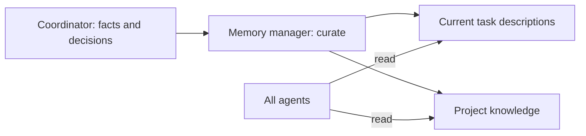

# Project memory

Froggy keeps two things: **simple task tracking** and **valuable project knowledge**.
The goal is to recover what matters, not to preserve a journal of everything that happened.

## Tasks

A task has a stable **ID**, **title**, **status**, and **detailed description**.
Statuses are `todo`, `in-progress`, `blocked`, `review`, and `done`.

The description holds scope, acceptance, current state, next step and useful evidence links.
Keep session/workspace references there when needed to resume work. Title, status and
description must agree with the current established state: replace obsolete blockers,
assignments and former current-state sections rather than keeping a succession of snapshots.
There are no task notes, update feeds or history sections. `save` replaces supplied fields;
it does not append a timeline. Read the current task with `get`, then replace its description
using the returned `expectedVersion`. Keep unique constraints, unresolved risks and recovery
links when removing obsolete prose. Detailed trials stay in linked reports; do not create
reports merely to relocate redundant updates.

The coordinator decides assignments and acceptance. A dispatched worker is not proof of
execution, and a passing static check is not proof that the product objective is achieved.

## Project knowledge

Each entry has an **ID**, **topic**, **title**, and **content** in Markdown.
Topics fit the project: for example `constraints`, `performance`, `build` or `runtime`.
Include useful source links in the content, not separate metadata fields.

Keep information that can change a future decision:

- user constraints and safety limits;
- reproducible performance tips and their conditions;
- build pitfalls, failure causes and recovery procedures;
- non-obvious project facts and design decisions with their reasons.

For example, a 6 GiB memory ceiling or a measured scheduler optimization belongs here.
“Trial #14 launched; results pending” belongs in the task. Raw logs stay in linked files.
Do not duplicate facts already adequately covered by project instructions or documentation.

A knowledge entry states the current conclusion, its conditions and uncertainty, and evidence
links, not the investigation chronology. Replace obsolete explanations when evidence establishes
the replacement instead of appending contradictory verdicts. Keep a refuted lead only when it
helps avoid repeating a mistake: summarize the failed approach, its conditions and the reason,
with a source link. Keep detailed trial sequences, timestamps and measurements in linked reports.

For example, when several trials isolate a capture-only crash and validate a local fix,
retain the failure mechanism, affected configuration, fix, validation limits and report link.
The task holds the remaining blocker and next action, not another copy of each trial.

## The memory manager decides

All agents read directly. **Only `memory-manager` writes tasks and knowledge.**
The coordinator supplies verified new facts, decisions, obsolete conclusions, bounded scope
and evidence—not final prose to copy or a requirement to preserve every previous chain.
The manager decides what to add, correct, merge, refuse or remove.
`No change` is a valid result; quantity is not a quality measure.

Before creating an entry, the manager searches for an existing home. It preserves uncertainty
and does not invent acceptance or authorization. Old or rarely read knowledge is not
automatically useless. Unique constraints, unresolved risks and recovery information stay
unless explicit evidence supersedes them. Preserve recoverability, not exhaustive chronology;
size alone is not a deletion criterion. Explicit user retention instructions still apply.
If unique information cannot safely be condensed or its evidence is missing, report the
limitation rather than discarding it or inventing a report.

`knowledge remove` is **permanent deletion**, with no archive or undo. Read the full entry
first. Save and verify merged content before deleting duplicates, and reconcile affected
references. When uncertain, keep the entry. The handback lists changed IDs, returned
versions, deletion reasons, conflicts and partial writes.

The coordinator checks the resulting affected titles, statuses, blockers and next steps against
its decisions and the supplied evidence, including necessary recovery references. A saved-record
receipt proves persistence, not that the updated state is coherent or that acceptance was met.

Tool checks restrict mutations to the manager's agent context. This is not an OS sandbox:
agents must not bypass the tools with SQL, shell or file edits.

## Reading and writing

Use `/memory`, `/task-board` and `/knowledge` to inspect tasks and knowledge without modifying them. Each command calls one tool; the tool returns Markdown and the model relays it unchanged. Read the relevant task with `task-board get`. Discover knowledge with `topics`/`list`/`search`,
then `get` only matching entries. Do not load the whole project on every reminder.
`project-rules`, if present, is an ordinary knowledge entry, not a special backend.

Tools return complete Markdown, but rendering may be truncated. Narrow discovery with a
status, topic or query. Before replacing a description or content, read the full affected
record and obtain any missing text through an authorized path. If any part remains unread
or inaccessible, stop that replacement and report incomplete coverage; excerpts and summaries
are not enough. Record `get` shows the current version. Lists are discovery views, not
immutable snapshots while other sessions write.

Each task's metadata and description are read together. The plugin does not cap Markdown
responses or impose a display-driven limit on descriptions or knowledge content.

Create records without `expectedVersion`. Updating or removing an existing record requires
its current version. Versions are opaque conflict guards, not public history; never calculate
the next value. On conflict, report it and reread before deciding how to reconcile.

## On-demand global review

Run `/memory-review` to ask the manager for a **report before any changes**. The read-only
`memory-review` tool inventories all topics and counts, in pages; it does not judge content
or invoke an agent. The manager then reads every knowledge entry with the existing tools,
checking duplicates across topics, contradictions, obsolete claims and useful missing facts.
Tasks are consulted only for context or affected references, not audited or changed.

The report states actual coverage, proposed changes with IDs/versions and reasons, and any
uncertainty or incomplete reads. It is not a frozen snapshot. No review changes are applied
until the user validates the proposals; application is a separate manager pass using fresh
versions. There is no scheduled global sweep. Without a database or the current schema,
the inventory reports a blocker instead of creating or migrating a store.

## Tool reference

| Tool | Actions | Record fields |
|---|---|---|
| `task-board` | `list`, `get`, `save` | `id`, `title`, `status`, `description`; updates require the task's `expectedVersion` |
| `knowledge` | `topics`, `list`, `search`, `get`, `save`, `remove` | `id`, `topic`, `title`, `content`; `query` searches text |
| `memory-overview` | none | Read-only store path, task counts by status and knowledge topics |
| `memory-review` | `page` | Read-only inventory: `knowledgeCount`, `topicCount`, `topics` and `nextPage` |

`task-board`, `knowledge` and `memory-overview` return Markdown; their write actions return
JSON receipts. `expectedVersion` guards updates. Task lists filter by `status`; knowledge
lists/searches filter by `topic`. The live tool schemas are the parameter reference.
Use `memory-overview` to consult memory and `memory-review` only to prepare a cleanup audit.

## Storage and upgrades

One SQLite database lives at `<canonical-project>/.opencode/memory/memory.db`, shared
across project worktrees. New stores contain only `tasks` and `knowledge`, with internal
versions and timestamps. Reports and session history remain separate.

On first write access to the previous structured schema, Froggy creates and verifies a standalone
`memory.db.pre-simple-<unique-id>.bak` before converting in a transaction. Task details and
references move into the description; active knowledge retains content and source links.
Oversized legacy titles/topics get bounded labels with their full originals retained in the content.
Archived tasks become `done` with an explanatory description. Superseded notes and old
revisions remain in the backup, not the current store. IDs are preserved; versions reset.
Failed conversions roll back. Stop old plugin instances before upgrading; mixing schemas
is unsupported. Backups are never automatically deleted or published. Reads never create or
upgrade the store: they report a missing database or an outdated schema instead.

The Markdown memory tool has been removed. Existing Markdown files are neither imported
nor deleted automatically. A project still using them needs an explicit migration, not two
simultaneously authoritative stores. The database and its backups are local project data:
code commits do not protect them unless explicitly included.

Progress-note removal adds no migration, schema version or compatibility layer. Existing
databases and backups are not rewritten, and former task-note content is not copied into
descriptions. The removed actions and fields are rejected rather than silently ignored.
