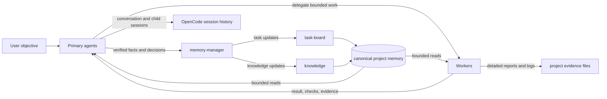
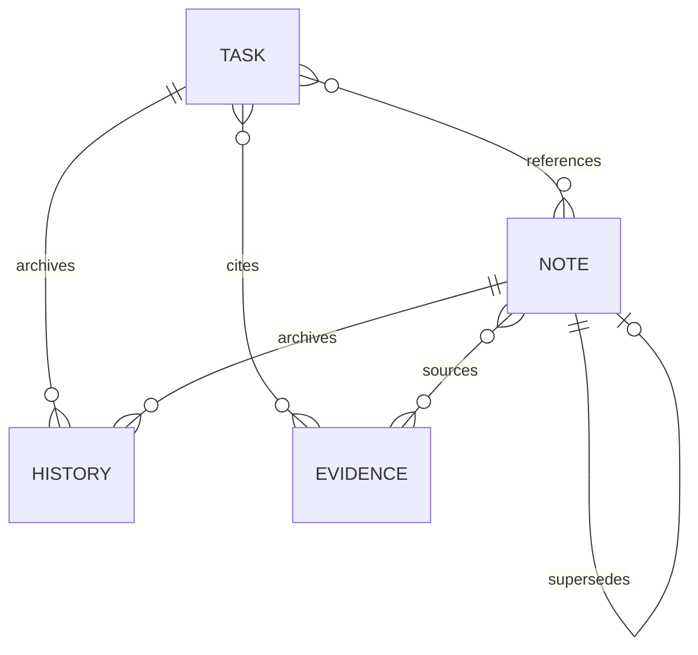
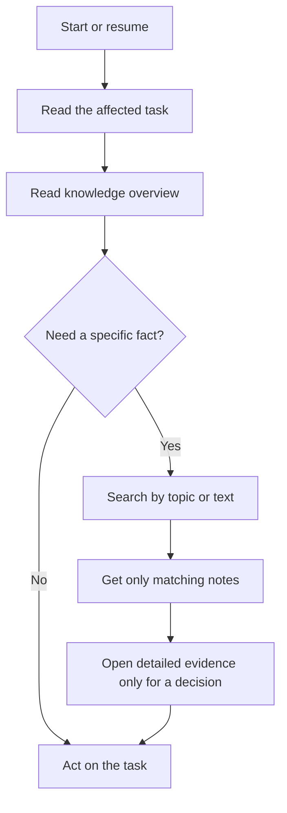
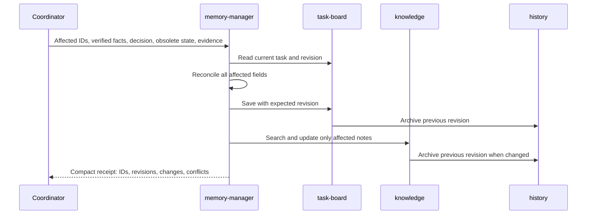
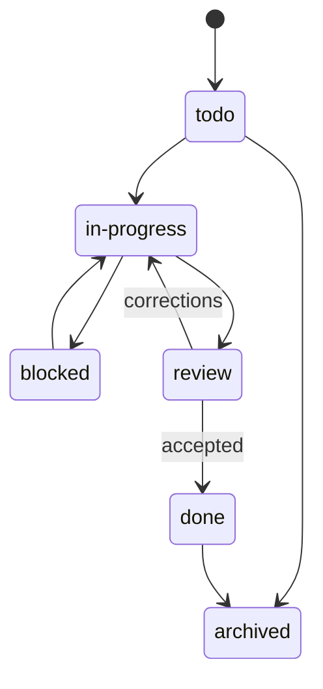
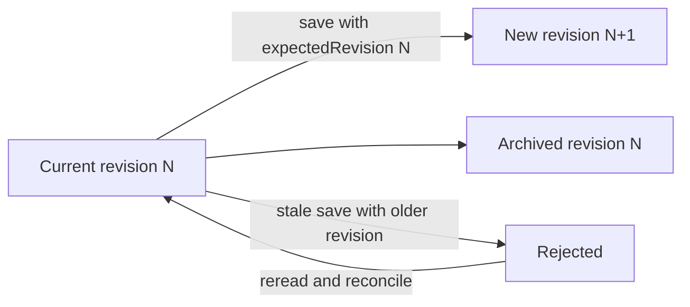

# Project memory

Project memory exists so that a later session can answer two different questions without rereading an entire conversation or a giant Markdown file:

1. **What are we doing now, and what should happen next?**
2. **What durable knowledge should change a future decision?**

Froggy separates those questions into an operational task board and a durable knowledge store. Detailed evidence stays in files, and conversation history stays in sessions.

[Back to README](../README.md)

## Contents

- [Two stores, one authority](#two-stores-one-authority)
- [What lives where](#what-lives-where)
- [Who can do what](#who-can-do-what)
- [System architecture](#system-architecture)
- [Record model](#record-model)
- [Reading memory](#reading-memory)
- [Recording a transition](#recording-a-transition)
- [Task lifecycle](#task-lifecycle)
- [Knowledge organization](#knowledge-organization)
- [Revisions, history, and conflicts](#revisions-history-and-conflicts)
- [A coherent update](#a-coherent-update)
- [Tool reference](#tool-reference)
- [Placement rules](#placement-rules)
- [Anti-patterns](#anti-patterns)
- [Legacy Markdown](#legacy-markdown)
- [Persistence and scope](#persistence-and-scope)
- [Quick checklist](#quick-checklist)

## Two stores, one authority

New projects use one database per canonical project:

```text
<canonical-project>/.opencode/memory/memory.db
```

Worktrees of the same project share that database. Separate projects get separate databases. There is no cross-project memory and no automatic synchronization with a remote tracker.

| Store | Question it answers | Example content |
|---|---|---|
| `task-board` | What is happening now? | Objective, status, blocker, next action, assignments, evidence references |
| `knowledge` | What should future work remember? | Constraints, decisions, facts, lessons, source references |
| Evidence files | What proves it? | Reports, logs, measurements, test output |
| Session history | What was said and done? | Messages, child sessions, prior investigations |

The database is the operational authority for migrated projects. Evidence files and sessions remain authoritative for their own content; the task or note should point to them instead of copying them.

## What lives where

### Task-board content

A task is a compact current snapshot. It is not a diary.

| Field | Meaning |
|---|---|
| `title` | Short stable description |
| `status` | `todo`, `in-progress`, `blocked`, `review`, `done`, or `archived` |
| `objective` | Why the work exists and what outcome is wanted |
| `acceptance` | Observable conditions for completion |
| `currentState` | What is established now |
| `nextAction` | The next useful action, or the next decision needed |
| `blockers` | Actual unresolved obstacles |
| `knowledgeRefs` | IDs of relevant durable notes |
| `evidence` | Paths to reports, logs, measurements, or other durable proof |
| `assignments` | Current owners and their bounded work |
| revision | Version used for safe concurrent updates |

### Knowledge content

A note is organized by topic and kind:

| Kind | Use it for |
|---|---|
| `constraint` | A rule, safety limit, user requirement, or durable boundary |
| `decision` | A deliberate choice and its scope |
| `fact` | A verified project or environment fact |
| `lesson` | A reusable failure cause, correction, or non-obvious lesson |

Notes also have a title, content, source references, status (`active` or `superseded`), and an optional replacement note.

### What does not belong in memory

- Full logs, reports, or measurements. Put them in evidence files and link them.
- Every completed action or chronological milestone.
- Raw conversation transcripts.
- Secrets, keys, personal data, or private build artifacts.
- A second live backlog in Markdown or a remote tracker.
- A claim that a dispatched worker has already executed a run.

## Who can do what

| Actor | Read tasks | Read knowledge | Decide priority or acceptance | Save tasks | Save knowledge |
|---|---:|---:|---:|---:|---:|
| Any agent | Yes | Yes | No | No | No |
| `product-owner` | Yes | Yes | Product intent | No | No |
| `orchestrator` | Yes | Yes | Execution decisions | No | No |
| Workers | Yes | Yes | No | No | No |
| `memory-manager` | Yes | Yes | No | Yes | Yes |

The coordinator owns **decisions**. The memory-manager owns **representation and placement**.

That distinction prevents two failure modes:

- a coordinator quietly turning the task board into an unstructured diary;
- a curator inventing a decision, authorization, or execution result that the coordinator never supplied.

The tools do not invoke a model automatically. A meaningful transition must be delegated explicitly. Unchanged reminders and individual log lines do not trigger a curation pass.

## System architecture



The database stores the **current record**, not the full history of the project. Previous revisions are archived inside the same store and can be read on demand.

## Record model

This is a conceptual model, not a database schema.



A task points to the knowledge it needs and to the files that prove it. A note points to its sources and may point to a replacement note. History belongs to the record that changed.

## Reading memory

Start from the question, not from the whole store.



Recommended discovery path:

1. **Read the task** with `task-board` `list` or `get`.
2. **Get the knowledge overview** to see `project-rules` and available topics.
3. **Search** for the specific subject.
4. **Get only the matching notes**.
5. **Open a report or log** only when a decision or verification requires it.

Do not load every task and note at startup. A periodic reminder alone is not a reason to reread unchanged memory. Reuse facts already in context, and verify references against actual Git and session state when they matter.

If a result reports truncation or more pages, continue with the provided ranges or pages. Do not infer missing content.

## Recording a transition

A meaningful transition is more than a status change. It may affect the current state, next action, blocker, assignments, evidence, and related knowledge.



The handoff should contain:

- the affected task and note IDs;
- verified new facts;
- the coordinator's decision;
- the state that is now obsolete;
- evidence references;
- any unresolved contradiction.

It should not contain the whole conversation or prewritten memory prose.

### Reconciliation rules

- Read the current record before saving.
- Use the current revision.
- Save related task fields together in one update.
- Update an existing note instead of creating a duplicate.
- Mark a refuted note as superseded and link its replacement.
- Stop on a revision conflict instead of overwriting concurrent work.
- Report a contradiction before saving a disputed transition.
- Verify the saved result with a focused read.

## Task lifecycle

The statuses are a useful workflow, not an automatic state machine enforced by the storage layer.



Use the project's real process when it differs. The important rule is that `done` reflects verified acceptance, and that the task remains a current snapshot rather than a history of every attempt.

## Knowledge organization

Knowledge is grouped by broad topic. The exact topics adapt to the project; common examples are:

- `workflow`: how agents coordinate and record decisions;
- `safety`: limits, authorization, privacy, and run ownership;
- `build`: toolchain, packaging, and reproducible inputs;
- `runtime`: behavior of the system under test;
- `rendering`: graphics and presentation;
- `performance`: measurement and optimization;
- `workspaces`: worktrees, custody, and recovery.

Keep one authoritative home per fact. A task should link to a note rather than repeat its full content. A note should link to evidence rather than paste a report.

A good note changes a future decision. It is not a summary of the latest conversation.

## Revisions, history, and conflicts

Every successful update creates a new revision and archives the previous record. The current record stays small; history is read only when needed.



Rules:

- **Current** means the present state.
- **History** means evidence of an earlier state, not a current instruction.
- A stale write is rejected rather than silently overwriting a concurrent update.
- Reading history does not create a new revision.
- Migration or initial import may start at revision 1 with no synthetic old history; later real updates create history normally.

## A coherent update

Suppose a coordinator releases a hold and dispatches a worker, but no run has started yet.

**Before**

```text
currentState : HOLD active; no worker assigned
nextAction   : Obtain coordinator release
blockers     : Coordinator hold
assignments  : []
```

**Decision**

```text
HOLD released.
A worker is dispatched for a bounded verification.
Guest execution is not yet confirmed.
```

**After — one coherent save**

```text
currentState : HOLD released; worker dispatched; guest execution not confirmed
nextAction   : Await worker evidence before claiming execution
blockers     : (empty)
assignments  : general / ses_worker / bounded verification
```

The next action describes what to do next, not a narrative of what just happened. The old hold is removed from `blockers`; the assignment records the current owner; execution remains explicitly unconfirmed.

## Tool reference

### `task-board`

| Action | Purpose |
|---|---|
| `list` | Bounded task overview; filter by status |
| `get` | Read one task or one long field range |
| `save` | Create or update a task with a revision check |
| `history` | Page through prior revisions; select one revision to read it in ranges |

Common fields for `get`/`save` are `id`, `title`, `objective`, `acceptance`, `currentState`, `nextAction`, `blockers`, `knowledgeRefs`, `evidence`, `assignments`, and `expectedRevision`. Use `offset`, `limit`, `field`, and `item` for bounded reads.

### `knowledge`

| Action | Purpose |
|---|---|
| `overview` | Show `project-rules` and available topics |
| `search` | Find short matching notes |
| `get` | Read one note or one long field range |
| `save` | Create or correct a note with a revision check |
| `history` | Page through prior revisions; select one revision to read it in ranges |

Common fields are `id`, `topic`, `kind`, `title`, `content`, `sources`, `status`, `supersededBy`, and `expectedRevision`. Available kinds are `constraint`, `decision`, `fact`, and `lesson`; status is `active` or `superseded`.

Only `memory-manager` may use `save`. Exact parameter tables for the other tools are in [Reference](reference.md#utility-tools).

## Placement rules

| Information | Home |
|---|---|
| Current objective, status, next step | Task |
| Durable rule or safety limit | Knowledge note (`constraint`) |
| Accepted design choice | Knowledge note (`decision`) |
| Verified non-obvious fact | Knowledge note (`fact`) |
| Failure cause or reusable correction | Knowledge note (`lesson`) |
| Test output, logs, measurements | Evidence file |
| Conversation and worker messages | Session history |
| Temporary speculation | Conversation or a report, not durable memory |

A useful test: **if this disappeared, would a future decision become worse?** If not, it probably does not need a separate note.

## Anti-patterns

| Anti-pattern | Why it fails | Better behavior |
|---|---|---|
| Append every event to a ticket | The current state disappears in a chronology | Keep a current snapshot and link evidence |
| Leave an old hold in `blockers` | Contradictory state confuses the next agent | Reconcile every affected field |
| Treat a dispatched worker as a running process | Dispatch is not execution | Wait for evidence and state what is confirmed |
| Copy a report into a note | Duplicates the source and grows unbounded | Link the evidence path |
| Store the same fact in task and knowledge | Two authorities drift apart | Pick one home and reference it |
| Load the entire store at startup | Wastes context and hides the relevant fact | Overview, search, then get |
| Save directly from the coordinator | Bypasses curation and consistency checks | Delegate to the memory-manager |
| Keep a Markdown and SQLite backlog together | Two live authorities | Migrate once and keep one backend |
| Trust a stale revision | Overwrites concurrent work | Re-read and reconcile |

## Legacy Markdown

Markdown memory remains supported for projects that have not migrated. It is a compatibility path, not a second authority for a migrated project.

- Use the existing `.opencode/orchestrator/learnings.md` and `.opencode/backlog/` only while that project uses the legacy backend.
- The memory-manager may write explicitly delegated legacy files.
- Do not maintain Markdown and SQLite copies of the same live state.
- Before switching backends, reconcile open work, preserve IDs, constraints, review and recovery references, and verify the migrated state.
- Historical archives are evidence, not live instructions.

The structured store is the normal path for new projects.

## Persistence and scope

- The database is project data, not a replacement for Git history, reports, or session history.
- It is shared by worktrees of the same canonical project, but not by unrelated projects.
- Do not commit private memory, build artifacts, game data, credentials, or player data.
- Follow the project's backup and retention policy. A readable database is not automatically a backup.
- Reading the store does not prove that a worker is active, a run happened, or an experiment succeeded.

## Quick checklist

Before recording a transition:

- [ ] I know which task and notes are affected.
- [ ] I have verified facts and a coordinator decision.
- [ ] I have identified obsolete state.
- [ ] I have the exact evidence references.
- [ ] I will save related fields together with the current revision.
- [ ] I will search before creating a note.
- [ ] I will report conflicts instead of overwriting them.
- [ ] I will verify the saved result with a focused read.

## Related

- [Orchestration](orchestration.md)
- [Reference](reference.md)
- [Memory manager guidance](../agent/memory-manager.md)
- [Backlog management](../skill/backlog-management/SKILL.md)
