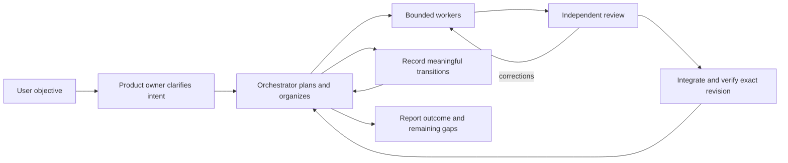
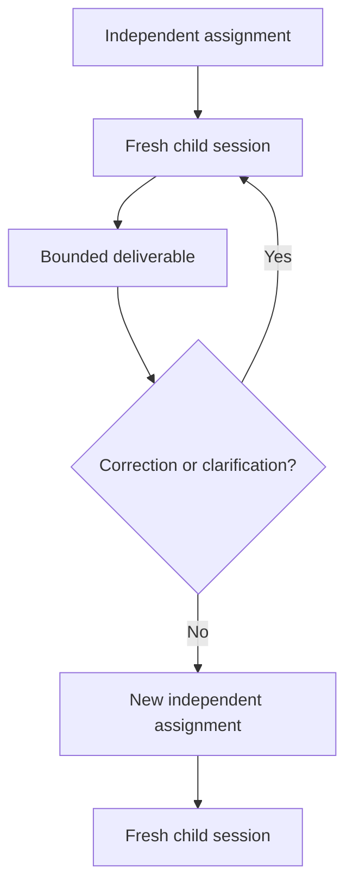
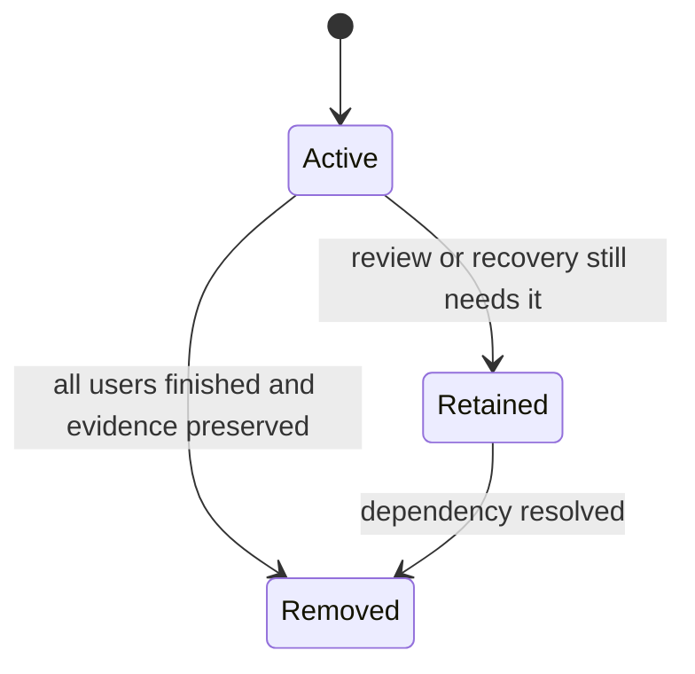
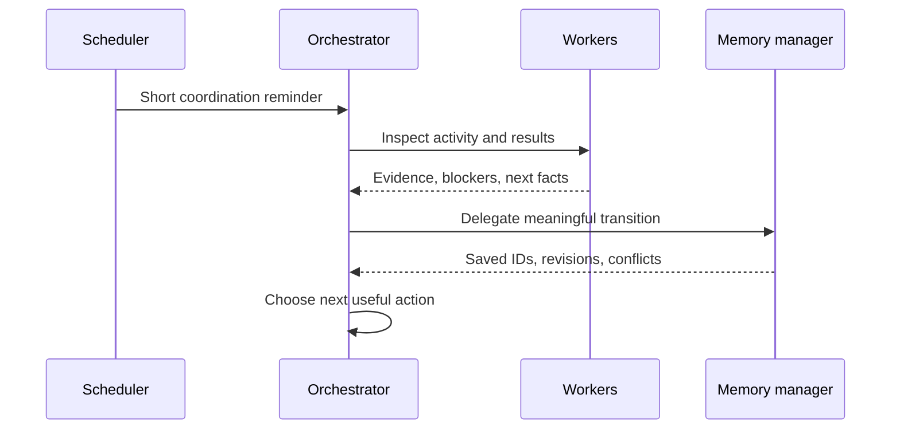

# Orchestration

Froggy turns an objective into coordinated work: primary agents decide what should happen, workers execute bounded assignments, reviewers challenge the result, and the orchestrator integrates only what has been verified.

This page explains the working model. It intentionally avoids plugin internals.

[Back to README](../README.md)

## Contents

- [Roles](#roles)
- [The delivery loop](#the-delivery-loop)
- [Delegation and sessions](#delegation-and-sessions)
- [Review and integration](#review-and-integration)
- [Workspaces](#workspaces)
- [Coordination loop](#coordination-loop)
- [Model configuration](#model-configuration)
- [Autonomy and authorization](#autonomy-and-authorization)
- [Common failure modes](#common-failure-modes)

## Roles

| Role | Owns | Does not own |
|---|---|---|
| `product-owner` | Product intent, scope, priorities, acceptance | Implementation or delivery claims |
| `orchestrator` | Execution decisions, delegation, integration, final reporting | Product commitments or unverified acceptance |
| Workers | A bounded deliverable, checks, evidence, blockers | Coordination state or independent approval |
| `code-reviewer` | Independent review of a non-trivial change set | Implementing the change |
| `memory-manager` | Faithful task and knowledge records | Execution decisions, authorization, acceptance |

The separation is deliberate:

- **The orchestrator decides what is true and what should happen next.**
- **The memory-manager records that decision consistently.**
- **All agents may read project memory directly.**
- **Only the memory-manager saves tasks or knowledge through the structured tools.**

A coordinator does not write memory prose itself. It supplies verified facts, decisions, affected record IDs, obsolete state, and evidence references; the memory-manager reconciles the record and returns a compact receipt.

## The delivery loop



The loop is not a fixed waterfall. Work can move backward when evidence changes, but authorization, review, and exact-revision checks are not skipped.

### 1. Understand and organize

Read the request, relevant project state, and existing evidence. Establish observable success criteria, real dependencies, and useful execution units. Do not invent requirements when the project can answer them.

### 2. Prepare the workspace

Choose an isolated branch or worktree for parallel or conflicting work. Sequential work may use the current workspace when existing work is preserved. Record the starting revision and keep one writer per workspace.

### 3. Delegate

Give each worker:

- the objective and acceptance examples;
- relevant findings and constraints;
- the workspace and starting revision when applicable;
- the exact scope and expected evidence;
- the safety and authorization limits that still apply.

Workers return a result, changes, checks tied to a revision, blockers, and evidence paths. They do not edit coordination state.

### 4. Validate and review

Check acceptance and real test evidence. A non-trivial change set needs an independent `code-reviewer` before integration or completion — including changes to logic, behavior, configuration, or agent instructions. Passing tests and implementer self-review do not replace independent review.

The reviewer receives the acceptance criteria, workspace, base and target revisions or working-tree scope, full diff, and test evidence. Confirmed blocking findings must be resolved or explicitly rejected with evidence.

### 5. Integrate incrementally

Use project conventions, preferably a fast-forward of a validated revision that includes the current target. Never force, reset, or overwrite another contributor's work. Re-run relevant checks after every synchronization, even when there are no conflicts.

### 6. Finish

Verify the combined result against the user's objective. Report what was delivered, what was not, and any remaining uncertainty. Integration is not deployment.

## Delegation and sessions

Use a fresh session for each independent assignment. Reuse a session only for clarification, correction, synchronization, or validation of that same deliverable — not merely because the role, model, repository, or objective is the same.



A useful worker handoff is short and evidence-based:

- result;
- changes;
- checks and the exact tested revision;
- blockers;
- evidence paths.

Detailed reports and logs stay in files. The handoff should not replay the whole investigation.

## Review and integration

Review is a gate, not a formality.

- Start a fresh reviewer for each independent change set.
- Review the actual diff, not only the implementer's summary.
- Separate correctness findings from optional polish.
- Reuse the original implementer and reviewer for corrections to that change set.
- Broaden the review if the design changes.
- Record the reviewer, reviewed revision or diff, findings, and disposition.

Checks attributed to a commit require that exact revision, with no staged, unstaged, or untracked code, tests, or configuration that could affect the result. Verify the revision and working-tree state before and after the checks. Use a clean validation worktree when existing changes would interfere.

## Workspaces

Temporary worktrees are part of delivery, not permanent project state. Release them incrementally when the associated work is genuinely finished.

Before removing a workspace:

1. verify every user of the directory has finished;
2. check running shells, background tools, and other processes;
3. preserve branches, recovery refs, and durable evidence outside the workspace;
4. move sessions to an existing checkout;
5. remove with a non-forcing strategy;
6. verify the resulting inventory and preserved refs.



Unknown ownership, unknown activity, failed preservation, or unsafe removal behavior means **retain**, not force. A completed worker execution alone is not proof that the workspace is free: pending review, corrections, integration, or another background process may still need it.

## Coordination loop

For sustained work, `start-orchestrator-loop` enables a persistent reminder loop for the current root orchestrator session. The default interval is ten minutes.



The reminder asks the orchestrator to:

- inspect current worker and background activity;
- reconcile results, reviews, and blockers;
- update the backlog through the memory-manager;
- release eligible workspaces;
- advance the next useful action without waiting for another user prompt.

The reminder does not fetch or inject child inventories, repeat the stored objective, or automatically remove workspaces. It does not prove that work progressed. Delivery happens at a step boundary and may be delayed by a running model request or tool.

Use `orchestrator-status` when loop state or delivery is uncertain. It reports stored settings, the local scheduler, pending reminders, and delivery diagnostics without waking execution. A successful wake request is not proof that the reminder was processed.

Stop the loop when the objective is achieved or the user asks. Stopping cancels pending reminders; already delivered reminders and running worker tasks are not interrupted.

## Model configuration

Models are configured in the first existing file:

1. project `.opencode/orchestrator.md`;
2. `~/.config/opencode/orchestrator.md`.

```markdown
complex: provider/model-a#max, provider/model-b#xhigh
normal: provider/model-c
```

- A model reference is `provider/model`, optionally with a variant such as `#max` or `#xhigh`.
- Each level is a comma-separated pool. Round-robin is the default; the orchestrator may choose another configured model when useful.
- `complex` and `normal` apply across ticket kinds.
- Reviewers and simplifiers default to the orchestrator's session model.
- Missing `complex` uses `normal`; missing `normal` or no configuration uses the session model.
- Commit the project file for a team standard, or keep it local for personal preferences.

## Autonomy and authorization

Routine technical choices, ticket adjustments, scheduling, and recovery do not need renewed approval. The orchestrator adapts after failures rather than stopping at a fixed retry count.

Irreversible, destructive, or costly actions need clear authorization, even inside the objective. Existing authorization does not need to be repeated, but it must be real and must cover the action.

With `orchestrator` selected, say **“Automatic mode”** to delegate remaining choices for the established objective without routine confirmation. Automatic mode belongs only to the orchestrator; the product owner and workers do not inherit it.

## Common failure modes

| Failure | Correction |
|---|---|
| Reusing a session because the role matches | Start fresh unless it is the same deliverable |
| Treating a dispatched worker as a finished run | Wait for evidence and distinguish dispatch from execution |
| Relying on an implementer's summary | Review the diff and checks |
| Running checks on a different revision | Verify exact SHA and working-tree state |
| Keeping a workspace because a session is inactive | Check background users and evidence, then reconcile explicitly |
| Letting the orchestrator rewrite memory directly | Delegate the transition to the memory-manager |
| Recording a chronology in every ticket | Keep a current snapshot and link detailed evidence |
| Skipping review for agent/configuration changes | Review non-trivial changes of every kind |

## Related

- [Project memory](memory.md)
- [Reference](reference.md)
- [Orchestrator guidance](../agent/orchestrator.md)
- [Backlog management](../skill/backlog-management/SKILL.md)
